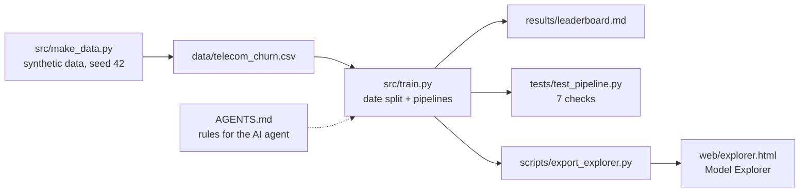
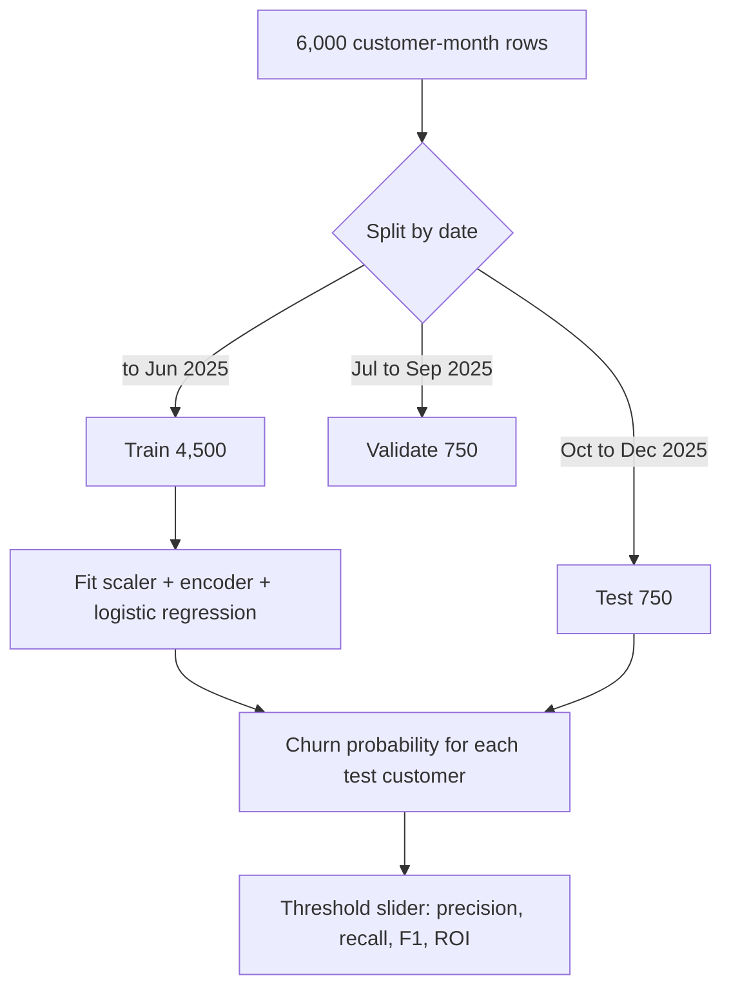

# Vibe Coding for Model Development: churn project

Predicts which telecom customers will cancel within 90 days, using synthetic data.

## Run the Python project
    mkdir -p data results
    pip install pandas numpy scikit-learn pytest tabulate
    python src/make_data.py      # synthetic data, seed 42
    python src/train.py          # writes results/leaderboard.md
    python -m pytest -q          # 7 verification checks
    python scripts/export_model.py   # optional: model numbers used by the web app

## Web app
Open web/index.html in any browser. No install needed. Enter customer details to see
the churn chance, and move the alert threshold to see flagged customers, caught churners,
missed churners and false alarms on the test period.

## Model Explorer (Lab 6)
Open web/explorer.html in any browser. It is one self-contained file. Four tabs:
- Predictor: enter a customer and see the churn chance.
- Threshold and ROI: live precision, recall, F1, caught/missed/false alarms, and estimated retention ROI.
- Features and calibration: permutation importance and a calibration chart.
- Model card: the content of MODEL_CARD.md.

To rebuild the explorer after retraining:

    python scripts/export_explorer.py   # writes the numbers into web/explorer.html

## Architecture

## Data flow

## Files
- src/          data generation and training
- tests/        7 automated checks
- AGENTS.md     rules for the AI agent
- MODEL_CARD.md what the model is, how it was tested, its limits
- web/          index.html (simple predictor) and explorer.html (Lab 6 Model Explorer)
- scripts/      export scripts for the web pages
- results/      leaderboard
